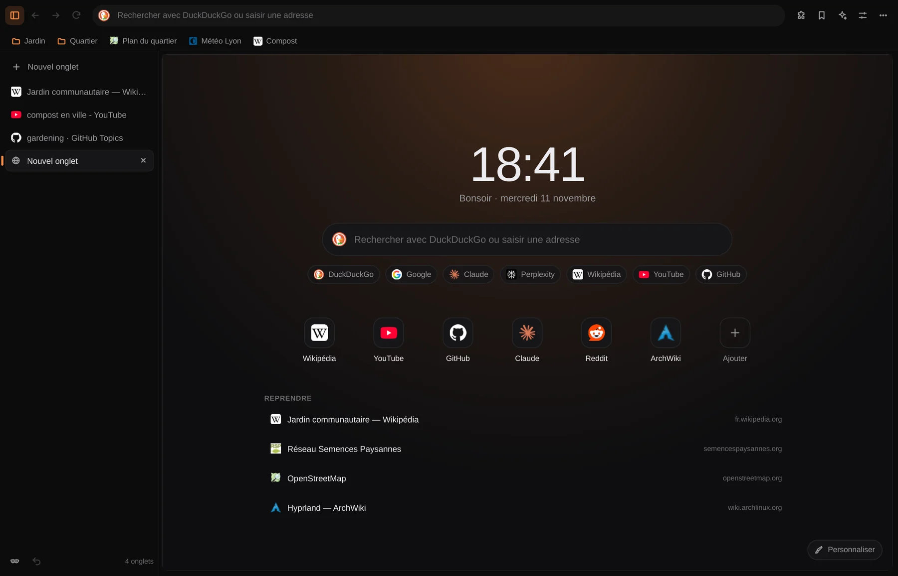

# Flair Web

Le navigateur de la suite flair : la même identité, le même thème que flair et Flair Code,
et une application à part qui s'utilise toute seule. Moteur Chromium (Qt WebEngine),
interface Qt Quick, tout se règle.



Une application de [la suite flair](https://vexlab-off.github.io/flair/), avec [flair](https://github.com/vexlab-off/flair),
[Flair Code](https://github.com/vexlab-off/flaircode) et [Flair Web](https://github.com/vexlab-off/flairweb).

## Installer

Sur Arch Linux et ses dérivées, avec le paquet de la
[dernière version](https://github.com/vexlab-off/flairweb/releases/latest) :

```sh
sudo pacman -U flairweb-0.2.0-1-x86_64.pkg.tar.zst
```

Ou en construisant le paquet soi-même depuis les sources de la version :

```sh
git clone https://github.com/vexlab-off/flairweb
cd flairweb/packaging/arch
makepkg -si
```

Il faut Qt 6 (base, declarative, webengine, wayland), xdg-desktop-portal et xdg-utils. En option : flair, qt6-imageformats, qt6-svg.

## Recherche, à ta façon

- **Le moteur que tu veux** : DuckDuckGo, Google, Brave, Startpage, Qwant, Ecosia, Bing,
  Kagi, Mojeek, SearXNG, et les moteurs à réponses (Claude, Perplexity, ChatGPT). Le choix
  est proposé au premier lancement, un autre moteur peut servir aux onglets privés.
- **Mots-clés** : `yt chats` cherche sur YouTube, `wiki Lyon` sur Wikipédia, `gh flair` sur
  GitHub, `aw hyprland` dans l'ArchWiki, `tr bonjour` avec DeepL… Le mot-clé suivi d'une
  espace devient une pastille dans la barre d'adresse. Les « bangs » marchent aussi :
  `!yt chats` ou `chats !yt`. Chaque mot-clé se change dans les réglages.
- **Tes propres moteurs** : n'importe quel site avec une page de résultats (`%s` à la place
  de la recherche), avec ses suggestions s'il en a. Les moteurs intégrés se modifient,
  se masquent et se réinitialisent.
- **Google et la page « je ne suis pas un robot »** : Google prend souvent les navigateurs
  basés sur Qt WebEngine pour des robots. Cocher la case suffit un moment ; un bandeau propose
  aussi de relancer la même recherche sur Startpage (résultats de Google) ou DuckDuckGo.
- **Suggestions** : du moteur, de l'historique, des favoris et des onglets ouverts
  (« Basculer vers l'onglet »). L'adresse d'un site déjà visité se complète pendant la
  frappe. Alt+Entrée ouvre dans un nouvel onglet, Ctrl+Entrée ajoute `www.` et `.com`,
  Maj+Suppr retire une suggestion de l'historique.

## Onglets

- **Sur le côté ou en haut** ; sur le côté, la colonne se redimensionne en tirant son bord et
  passe en icônes seules (Ctrl+B).
- **Épinglés** en grille d'icônes, **glisser** pour réordonner, clic du milieu pour fermer,
  clic droit pour dupliquer, couper le son, endormir, déplacer dans une nouvelle fenêtre…
- **Mise en veille** des onglets inactifs (30 min par défaut) : la mémoire est libérée,
  l'onglet se réveille quand tu y reviens.
- **Session** reprise au démarrage, onglets restaurés sans être rechargés tant qu'on ne
  les ouvre pas. Ctrl+Maj+T rouvre les onglets fermés.
- **Onglets privés** (Ctrl+Maj+N) : rien sur le disque, cookies et cache oubliés à la
  fermeture du dernier.

## Lire et comprendre

- **Mode lecture** (F9) : l'article seul, en serif ou sans, taille et largeur réglables,
  thèmes Flair, clair, sépia, sombre.
- **Assistant de page** (Ctrl+Maj+A) : résumer, points clés, expliquer simplement,
  traduire, vérifier, ou n'importe quelle question sur la page ou la sélection, avec
  Claude, OpenAI, Gemini ou un modèle local (LM Studio, Ollama). Clic droit sur une
  sélection : « Expliquer » ou « Traduire avec l'assistant ». Les clés de flair et de
  Flair Code sont reprises.
- Rechercher dans la page (Ctrl+F), PDF (Ctrl+P), page en `.mhtml` (Ctrl+S), code source
  (Ctrl+U), outils de développement (F12), zoom retenu par site.

## Confidentialité

- **Bouclier** : bloque pubs et traceurs avant qu'ils se chargent (liste intégrée, listes
  StevenBlack, Peter Lowe, HaGeZi téléchargeables, tes domaines), masque les emplacements
  vides, compte ce qu'il bloque sur chaque page. Un clic sur le cadenas le coupe pour un
  site.
- Cookies tiers bloqués, Do Not Track et Global Privacy Control, HTTPS uniquement en option,
  cookies de session, effacement à la fermeture, autorisations (caméra, micro, position…)
  demandées dans un bandeau et révocables site par site.
- Rien n'est envoyé ailleurs qu'aux sites visités et au moteur (pour les suggestions, qui se
  coupent). Les icônes de sites viennent des sites eux-mêmes.

## Liberté

- **Styles et scripts** : ton CSS et ton JavaScript sur toutes les pages, ou par site
  (`youtube.com`, `*.wiki*`), injectés avant l'affichage. Le cadenas d'un site mène
  directement à sa règle.
- **Extensions Chrome** (Manifest V3) : depuis le Chrome Web Store, où le bouton de la page
  devient « Ajouter à Flair Web » (le bandeau « Passez à Chrome » disparaît), ou par le puzzle de la
  barre d'adresse, un lien collé dans le menu Extensions, un `.crx`, un `.zip` ou un dossier. Qt WebEngine ne donne aux extensions que `runtime` et `storage` ;
  Flair Web fournit le reste : `tabs`, `windows`, `action` (boutons et badges dans la barre
  d'outils), `contextMenus`, `scripting`, `webNavigation`, `permissions`, `storage.sync`,
  `i18n`, et un moteur `declarativeNetRequest` dans le bouclier. Testé avec uBlock Origin Lite
  (blocage, scripts de remplacement, masquage des emplacements, compteur), NordPass,
  Bitwarden et Dark Reader. Les extensions ne voient jamais les onglets privés.
- **Identité** : se présenter comme Chrome, Firefox, Safari, un mobile ou un User-Agent à toi ;
  langues des pages ; mode sombre forcé des sites ; JavaScript, images, lecture automatique,
  WebGL, PDF, défilement doux, barres de défilement…
- **Thèmes Chrome** : un thème du Chrome Web Store s'installe avec le même bouton ; ses couleurs
  donnent l'accent et le mode clair ou sombre, son image le fond du nouvel onglet. Réglages →
  Apparence le retire.
- **Apparence** : couleur d'accent et mode partagés avec la suite flair (ou propres), page
  dans une carte ou bord à bord, arrondis, densité, barre de favoris toujours / sur les
  nouveaux onglets / jamais, chaque bouton de la barre d'outils, mode zen (Ctrl+Maj+F).
- **Nouvel onglet** : horloge, salutation, recherche, moteurs à portée de clic, raccourcis
  éditables (forme des tuiles, colonnes), reprise des dernières pages, fond lueur d'accent,
  dégradé, uni ou image.
- **Favoris** : dossiers, barre, import depuis Chrome, Chromium, Brave, Vivaldi, Edge, Opera
  ou un export HTML (Firefox, Safari), export HTML.

## Suite flair

- Couleur d'accent, mode clair/sombre et style du logo synchronisés avec flair et Flair
  Code ; l'icône du lanceur suit la couleur.
- « Afficher dans flair » sur les téléchargements, et à la fin d'un téléchargement si tu le
  veux.
- Les liens ouverts par les autres applications arrivent dans la fenêtre existante (une seule
  instance) ; « Définir par défaut » dans À propos ou Réglages → Démarrage.

## Raccourcis essentiels

| | |
|---|---|
| Ctrl+T / Ctrl+Maj+N / Ctrl+N | Nouvel onglet / privé / fenêtre |
| Ctrl+L, Ctrl+K | Barre d'adresse, choisir le moteur |
| Ctrl+W, Ctrl+Maj+T | Fermer, rouvrir |
| Ctrl+Tab, Ctrl+1…9 | Changer d'onglet |
| Ctrl+D, Ctrl+Maj+O, Ctrl+H, Ctrl+J | Favori, favoris, historique, téléchargements |
| Ctrl+Maj+A, F9 | Assistant, mode lecture |
| Ctrl+Maj+P | Toutes les commandes et les onglets |
| Ctrl+, , F1 | Réglages, raccourcis |

## Construire

```sh
bin/build     # build/flairweb
bin/test      # tests unitaires (hors écran)
bin/install   # paquet Arch (makepkg -fsi)
```

`flairweb [adresse…]`, `flairweb --private`, `flairweb --new-window`.

Les logos des moteurs intégrés sont dans `src/logos/<clé>.png` (64 px, pris sur le site de chaque
moteur ; `<clé>-dark.png` pour les logos noirs, en blanc sur fond sombre). Les autres sites ont leur
icône, demandée au site lui-même (`/favicon.ico`, sinon celle que déclare sa page d'accueil).

`FLAIRWEB_STARTUP_LOG=1` affiche le temps de chaque étape du démarrage (profil, QML, première
image de la fenêtre, extensions prêtes, première page chargée). La fenêtre n'attend pas les
extensions : seules les pages restaurées attendent qu'elles soient chargées (3 s au plus), pour que
leurs scripts s'y appliquent.

Pour essayer l'interface sans écran : `FLAIRWEB_SNAPSHOT=out.png` (avec `FLAIRWEB_SNAPSHOT_DELAY`)
enregistre la fenêtre et quitte ; `FLAIRWEB_DEV` enchaîne des étapes séparées par ` ;; `
(`FLAIRWEB_DEV_INTERVAL` ms entre deux, 2500 par défaut) : `open:<url>`, `click:x,y`, `rclick`,
`mclick`, `double`, `hover`, `keys:texte`, `key:Ctrl+W`, `resize:l,h`, `snap:fichier.png`, `state`,
`js:<code>`, `settings:<page>`, `panel:<nom>`, `palette`, `menu`… Lancer ces essais avec `HOME` et
les `XDG_*_HOME` dans un dossier à part, pour ne pas toucher à la session réelle. Les réglages sont dans
`~/.config/flairweb/flairweb.conf` (mode 0600), l'historique, les favoris et la session dans
`~/.local/share/flairweb` (les variables `XDG_CONFIG_HOME`, `XDG_DATA_HOME` et `XDG_CACHE_HOME`
sont respectées).

### Comment marchent les extensions

À l'installation, Flair Web prépare une copie de l'extension : une passerelle (`src/extension/`)
est chargée avant son script de fond et ses pages, un relais avant ses scripts de contenu. La
passerelle parle à Flair Web par un WebSocket local (127.0.0.1, vérifié par l'origine de
l'extension et un secret) ; `Extensions.qml` répond avec les vrais onglets et fenêtres. Les
règles réseau des bloqueurs sont appliquées en C++ (`src/dnr.cpp`). `FLAIRWEB_EXTLOG=1` trace
les appels, la console et les erreurs des extensions ; `tests/extension-selftest` exerce l'ensemble.

## Licence

MIT, voir [LICENSE](LICENSE). La suite flair est créée par vex.
